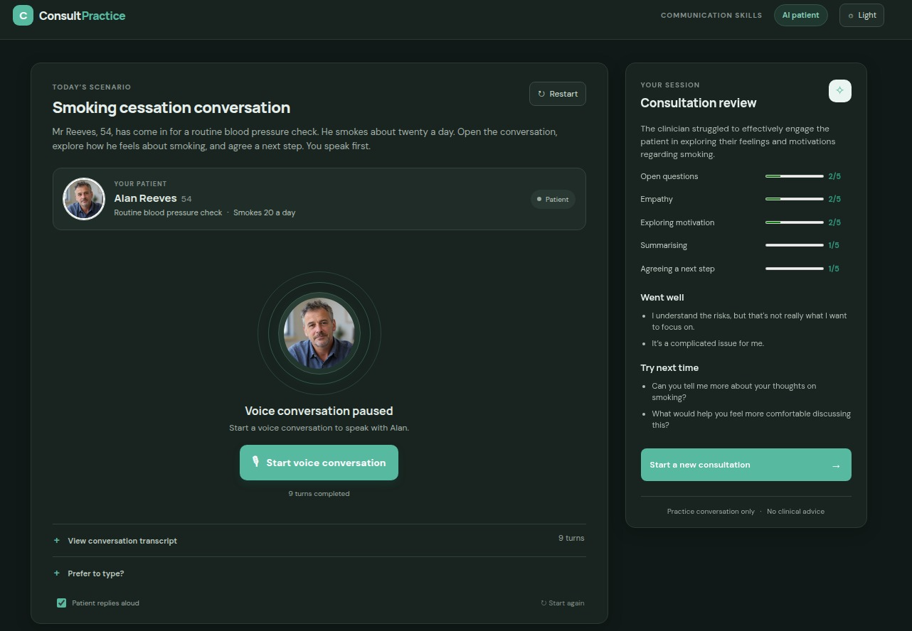
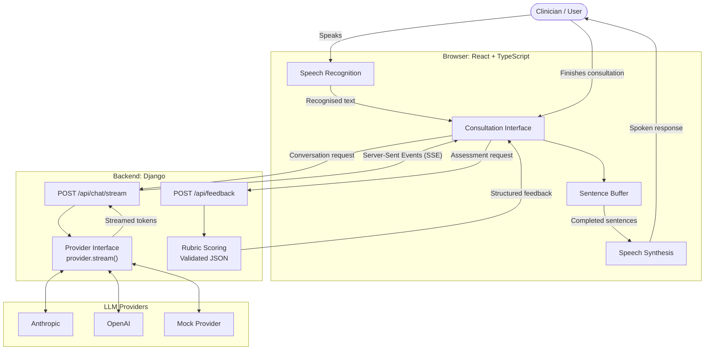

# Consultation practice: voice role-play demo

A small voice-enabled role-play simulator. You play a clinician, an AI plays a patient, and a short
rubric-based review follows. Built to show a Django + React/TypeScript stack with a streaming voice loop.



**Scenario:** a smoking cessation conversation with a fictional patient (Mr Reeves). It is a communication
exercise only and gives no clinical advice.

## How it works



- **Streaming responses:** Django sends model output to the browser as Server-Sent Events (SSE).
  The client buffers incoming text and begins speaking each completed sentence before the
  full response has arrived.

- **Interruptible speech:** Starting a new response or ending the voice session aborts the
  active request and cancels queued speech.

- **Provider abstraction:** `roleplay/llm.py` defines a common `Provider` interface.
  Anthropic, OpenAI and a keyless mock provider implement `stream()`.

- **No transcript persistence:** The backend does not store consultation transcripts in a
  database. Conversation content is held in the browser during the session and sent to the
  selected LLM provider for response generation and feedback.

- **Server-side input checks:** The API validates message count, allowed roles, non-empty
  content, message length and required conversation boundaries before processing messages.


## Run it

```bash
# backend
cd backend
python -m venv .venv && source .venv/bin/activate
pip install -r requirements.txt
export ANTHROPIC_API_KEY=...        # or OPENAI_API_KEY; with neither, a scripted mock patient is used
python manage.py runserver

# frontend (second terminal)
cd frontend
npm install
npm run dev                         # http://localhost:5173, /api is proxied to Django
```

Tests: `cd backend && python manage.py test`

## Limits (deliberate)

- Speech uses the browser's Web Speech API (best in Chrome or Edge). Typing works everywhere.
- Turn-based, not full-duplex realtime audio (no WebRTC), and no avatar.
- One scenario, one rubric. The mock feedback is keyword-based and only for demos.
- Run with `runserver` (WSGI) for simple streaming; production would use ASGI with an async view.
